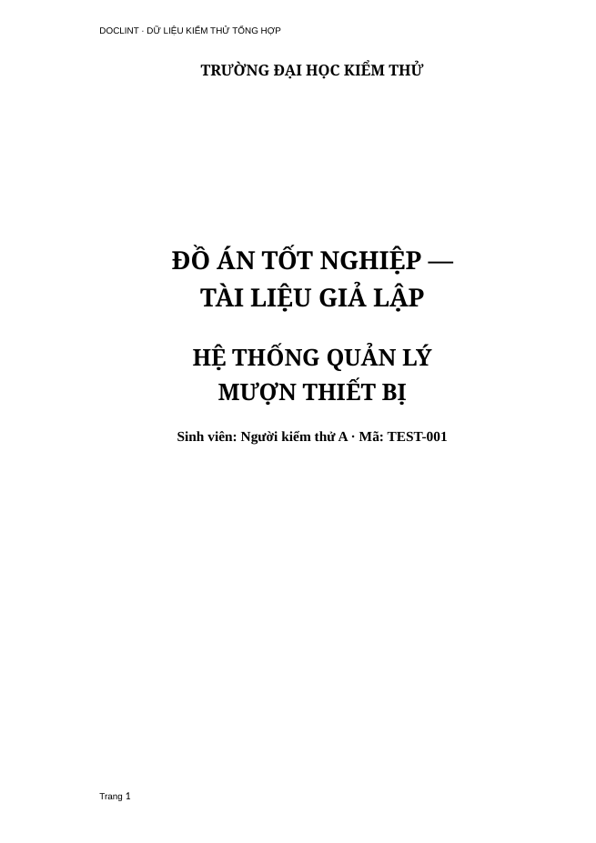

# Sửa nhận diện và định dạng bìa — V0.1.3

Bìa `01_do_an_tong_hop.docx` trước đây chỉ sửa tên trường và loại đồ án. Tên đề tài không dùng Style Subtitle bị bỏ qua; dòng sinh viên vẫn Arial 18 pt, căn trái; thiếu đoạn đệm khiến mọi dòng dồn sát đầu trang.

Bản này nhận bìa theo một nhóm có giới hạn: tên trường/khoa, loại đồ án, tên đề tài/tên tiếp và các trường sinh viên có bằng chứng. Dừng trước lời cảm ơn, tóm tắt, đề tài tốt nghiệp, mục lục hoặc chương. Một cụm “đồ án tốt nghiệp” trong thân bài không đủ để suy ra bìa.

| Thành phần mẫu tổng hợp | Định dạng mới |
|---|---|
| Trường | ArnoPro 15 pt, đậm, căn giữa |
| Loại đồ án | ArnoPro 25 pt, đậm, căn giữa |
| Tên đề tài không dùng Subtitle | ArnoPro 23 pt, đậm, căn giữa |
| Sinh viên | Times New Roman 14 pt, đậm, căn giữa |

Bìa ngắn có trường–tiêu đề liền nhau và không có logo/đoạn đệm/ngắt trang được đặt khoảng trước tiêu đề 160 pt, gần vị trí tiêu đề trong mẫu nguồn. Khối tiêu đề dài nằm trong dải căn giữa 70% vùng chữ để ngắt dòng cân đối mà không thêm ngắt dòng, thay chữ hoặc giảm cỡ. Đây là chính sách trình bày cho bìa ngắn, không phải thông số bắt buộc trích từ mẫu. Bìa có đoạn đệm giữ các đoạn đó và không nhận thêm khoảng 160 pt. Font, cỡ và khoảng đoạn của các vai trò có sẵn trong mẫu vẫn được đối chiếu riêng.

Hỗ trợ thêm tên sinh viên đặt sau nhãn riêng hoặc tên in hoa đứng trước email; mã/lớp, email, ngành/chuyên ngành, giảng viên và địa điểm có nhãn rõ. Không tự điền giá trị còn thiếu. Logo, chữ ký, khung và bảng có sẵn không được dựng lại; đoạn chứa đối tượng/khóa không an toàn được giữ và có cảnh báo.

[Tải DOCX mẫu tổng hợp đã chỉnh bằng web/API](examples/01_do_an_tong_hop_v0.1.3.docx). Đây là kết quả trên dữ liệu tổng hợp, không phải đáp án chuẩn độc lập. Nội dung header/footer “dữ liệu kiểm thử” và nhãn “tài liệu giả lập” thuộc nguồn, được giữ nguyên.

ArnoPro là tên phông trong Style Subtitle của file mẫu người dùng. Phông này không được phân phối trong repo. Ảnh minh họa được dựng bằng LibreOffice ngoài ứng dụng, môi trường có thể thay phông khi thiếu ArnoPro; để đối chiếu chính xác trên Word cần phông hợp lệ. Không coi ảnh là nghiệm thu bố cục trên Microsoft Word.

Kiểm thử gồm ca bìa không có Subtitle, tên đề tài nhiều đoạn, nhãn/tên sinh viên tách riêng, các trường ngành/email, ranh giới thân bài, đoạn đệm/logo, định dạng chữ xung đột và chạy lại hai lần. Toàn bộ 51 tiêu đề/chú thích trong file mẫu nguồn vẫn được kiểm kê đúng vai trò và thông số định dạng. [Hồ sơ kiểm chứng hiện tại](validation-v0.1.3.json).
